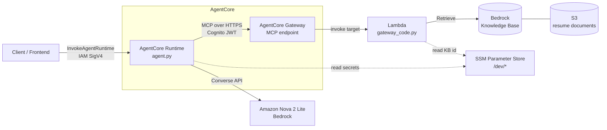

# Resume Agent: RAG on AWS with Bedrock AgentCore

A serverless AI agent that answers questions about a set of resumes. It runs on **Amazon Bedrock AgentCore Runtime**, reaches its tools through an **AgentCore Gateway** secured with **Cognito JWT**, and retrieves resume content from a **Bedrock Knowledge Base** through a **Lambda** function.

Ask a question such as *"Which candidate has the most AWS experience?"* and the agent decides when to call the retrieval tool, grounds its answer in the retrieved resume text, and returns the result.

---

## Architecture



**Request flow**

1. A caller sends `{"prompt": "..."}` to the AgentCore Runtime (IAM-authenticated).
2. The agent fetches Cognito client credentials from SSM, gets a token, and opens an MCP session to the Gateway.
3. The Gateway exposes the retrieval tool; the agent lists tools and passes them to the model.
4. The model (Nova 2 Lite via the Bedrock Converse API) decides to call the tool.
5. The Gateway invokes the Lambda, which queries the Knowledge Base and returns trimmed chunks (`text`, `score`, `source`).
6. The model writes the final answer from the retrieved context.

---

## Tech stack

| Layer | Technology |
|---|---|
| Agent hosting | Amazon Bedrock AgentCore Runtime |
| Agent framework | LangChain (`create_agent`), `langchain-aws`, `langchain-mcp-adapters` |
| Model | Amazon Nova 2 Lite (Bedrock Converse API) |
| Tool access | AgentCore Gateway (MCP) |
| Gateway auth | Amazon Cognito (JWT) |
| Retrieval | Bedrock Knowledge Base (managed) over S3 |
| Tool backend | AWS Lambda (Python 3.13) with a custom layer |
| Config & secrets | SSM Parameter Store |
| Infrastructure as code | Terraform (IAM policies) |
| Observability | OpenTelemetry spans and CloudWatch Logs |

---

## Repository layout

```
resume-agent/
├── agent.py            # AgentCore entrypoint + LangChain agent
├── mcp_client.py       # Cognito token fetch + MCP session to the Gateway
├── gateway_code.py     # Lambda: Knowledge Base retrieval tool
├── requirements.txt    # Agent dependencies
├── terraform/          # IAM policy for the runtime role
└── README.md
```

> Adjust the layout above to match your repo.

---

## Prerequisites

- An AWS account with Bedrock model access enabled in `us-east-1`
- AWS CLI configured (`aws sts get-caller-identity` works)
- Python 3.10+ (3.13 used here)
- A Bedrock Knowledge Base with your resume documents synced from S3
- A Cognito user pool and app client for the Gateway
- An AgentCore Gateway with the Lambda registered as a target
- Terraform (optional, for the IAM policy)

---

## Setup

### 1. Store configuration in SSM

Secrets live in Parameter Store, not in the deployment. The agent receives only the *names* of the parameters.

```bash
aws ssm put-parameter --name /dev/cognito_client_id     --type SecureString --value "<client-id>"
aws ssm put-parameter --name /dev/cognito_client_secret --type SecureString --value "<client-secret>"
aws ssm put-parameter --name /dev/resume-kb-id/KB       --type String       --value "<knowledge-base-id>"
```

### 2. Deploy the retrieval Lambda

`gateway_code.py` reads the KB ID from SSM and calls `bedrock-agent-runtime.retrieve`.

Environment variables:

| Variable | Purpose |
|---|---|
| `KB_ID_PARAM` | SSM parameter name that holds the Knowledge Base ID |
| `NUM_RESULTS` | Number of chunks to return (default `5`) |
| `LOG_RETRIEVED_CHUNKS` | `true` to log chunks for debugging |

Notes:

- The Lambda needs `ssm:GetParameter` and `bedrock:Retrieve`.
- A **managed** Knowledge Base only accepts `managedSearchConfiguration`. The boto3 version built into the Lambda runtime is too old to know that field, so ship a newer boto3 in a **Lambda layer** (see Troubleshooting).

Test event:

```json
{ "query": "Which candidates have experience with Python and AWS?" }
```

### 3. Create the Gateway

Create an AgentCore Gateway with Cognito JWT inbound auth and register the Lambda as a target. Note the Gateway MCP URL and the Cognito token endpoint.

### 4. Configure and deploy the agent

```bash
python -m venv .venv
source .venv/Scripts/activate        # Windows Git Bash. Use .venv/bin/activate on Linux/macOS
pip install -r requirements.txt

agentcore configure --entrypoint agent.py
agentcore deploy \
  --env AWS_REGION=us-east-1 \
  --env AWS_BEDROCK_MODEL_ID=us.amazon.nova-2-lite-v1:0 \
  --env CLIENT_ID_PARAM=/dev/cognito_client_id \
  --env CLIENT_SECRET_PARAM=/dev/cognito_client_secret
  # plus the Gateway URL and token endpoint variables that mcp_client.py reads
```

> **Windows / Git Bash:** run `export MSYS_NO_PATHCONV=1 MSYS2_ARG_CONV_EXCL="*"` first, or Git Bash will rewrite values that start with `/`. See Troubleshooting.

### 5. Grant the runtime role access to SSM

The auto-created execution role cannot read your parameters. Add the policy in `terraform/`:

```hcl
resource "aws_iam_role_policy" "agentcore_ssm_read" {
  name = "ssm-read"
  role = var.agentcore_role_name

  policy = jsonencode({
    Version = "2012-10-17"
    Statement = [{
      Effect = "Allow"
      Action = ["ssm:GetParameter", "ssm:GetParameters", "ssm:GetParametersByPath"]
      Resource = [
        "arn:aws:ssm:us-east-1:${data.aws_caller_identity.current.account_id}:parameter/dev",
        "arn:aws:ssm:us-east-1:${data.aws_caller_identity.current.account_id}:parameter/dev/*"
      ]
    }]
  })
}
```

The role also needs permission to invoke the Bedrock model (including the inference profile).

---

## Usage

### Local

```bash
python agent.py                      # starts the AgentCore app (default port 8080)

curl -X POST http://localhost:8080/invocations \
  -H "Content-Type: application/json" \
  -d '{"prompt": "What is the most impressive thing in the resumes?"}'

curl http://localhost:8080/ping      # health check
```

### Deployed

```bash
agentcore invoke '{"prompt": "Which candidate has the most AWS experience?"}'
```

Or from Python:

```python
import json, uuid, boto3

client = boto3.client("bedrock-agentcore", region_name="us-east-1")
resp = client.invoke_agent_runtime(
    agentRuntimeArn="<your-agent-runtime-arn>",
    runtimeSessionId=str(uuid.uuid4()) + "-resume-agent",   # long, unique
    payload=json.dumps({"prompt": "Which candidate has the most AWS experience?"}).encode(),
)
print(json.loads(resp["response"].read()))
```

---

## Observability

- **Application logs:** CloudWatch log group `/aws/bedrock-agentcore/runtimes/<agent-id>-DEFAULT`
- **Traces (spans):** log group `aws/spans`, which records each SDK call, its duration, and any exception
- **Lambda logs:** set `LOG_RETRIEVED_CHUNKS=true` to see what the Knowledge Base returned

```bash
aws logs tail /aws/bedrock-agentcore/runtimes/<agent-id>-DEFAULT --since 15m --follow --region us-east-1
```

---

## Troubleshooting (lessons learned)

| Symptom | Cause | Fix |
|---|---|---|
| `Unknown parameter: managedSearchConfiguration` | Lambda runtime ships an old boto3 | Bundle a newer boto3/botocore in a Lambda layer |
| `vectorSearchConfiguration is not supported for managed knowledge bases` | Wrong retrieval config for a managed KB | Use `managedSearchConfiguration` |
| `ModuleNotFoundError: bedrock_agentcore` on deploy | Dependency missing from `requirements.txt` | Add it and redeploy |
| `Runtime initialization time exceeded` | Slow or blocking work at import time | Keep module-level code light; do network calls inside request handlers |
| `500` with no useful log line | Error outside your logging, or logging not configured | Call `logging.basicConfig(level=logging.INFO)`; check the `aws/spans` log group |
| `AccessDeniedException` on `ssm:GetParameter` even with a correct IAM policy | The parameter *name* reaching the code was wrong (see below) | Inspect the runtime's actual environment variables |
| Env var arrives as `"\"/dev/..\""` | Quotes in `.env` passed literally by a deploy script | Strip quotes before passing `--env` |
| Env var arrives as `C:/Program Files/Git/dev/...` | Git Bash converts `/`-prefixed arguments to Windows paths | `export MSYS_NO_PATHCONV=1 MSYS2_ARG_CONV_EXCL="*"`, or deploy from PowerShell/WSL |
| `agentcore invoke` shows `>` prompts and never runs | An apostrophe in the JSON closed the shell quote | Avoid `'` in the prompt, escape it, or read the payload from a file |

**Tip:** when IAM looks right but access is denied, check the real values the runtime received:

```bash
aws bedrock-agentcore-control get-agent-runtime \
  --agent-runtime-id <agent-id> --region us-east-1 \
  --query "environmentVariables"
```

---

## Security notes

- Secrets are stored as SSM SecureStrings. Only parameter *names* are passed as environment variables.
- The runtime role is scoped to the `/dev/*` parameter path, not `*`.
- Runtime invocation uses IAM (SigV4); the Gateway uses Cognito JWT.
- Never commit `.env` files or credentials. Add `.env` to `.gitignore`.
- Add authentication and rate limiting before exposing any public endpoint, because every call spends model tokens.

---

## Roadmap

- [ ] React frontend hosted on S3 + CloudFront (OAC)
- [ ] Thin API layer (Lambda Function URL or API Gateway) in front of the runtime
- [ ] Conversation memory for follow-up questions
- [ ] Manage the full stack (runtime, roles, gateway) in Terraform
- [ ] CI/CD with GitHub Actions
- [ ] Retrieval quality and cost/latency evaluation tests

---

## License

MIT. See `LICENSE`.
